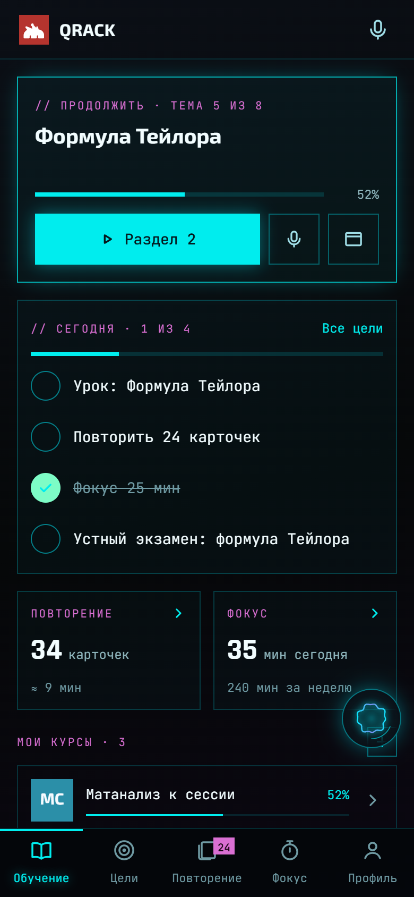
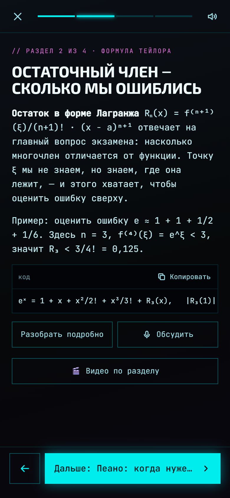
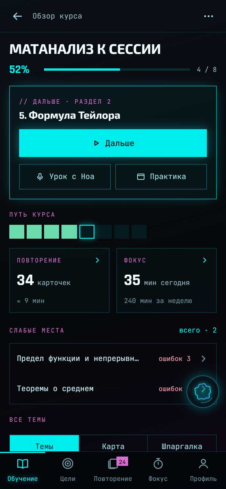
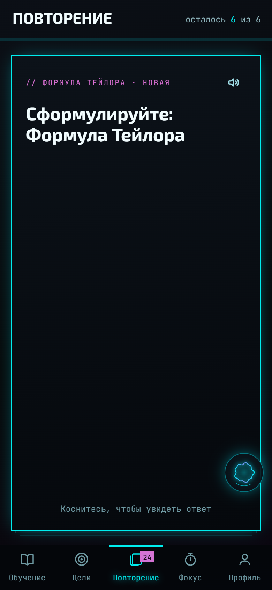
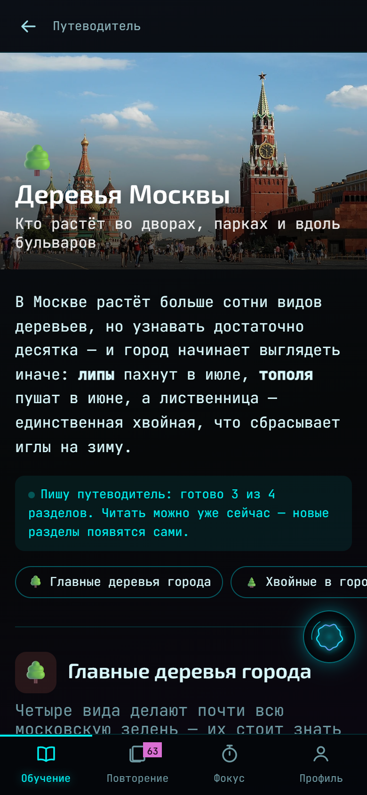

<div align="center">

# Qrack

**Крякни мозг: учись так, чтобы понял.**
Курс под твою цель, наставник голосом, практика, собеседование разговором и цели на день, неделю, месяц и год.



[**Открыть в браузере**](https://noahlab.ru/qrack/app/) · [Сайт](https://noahlab.ru/qrack/) · [MCP для нейросетей](https://noahlab.ru/qrack/mcp) · [Как это работает](#как-это-работает) · [Документация](docs/)

</div>

---

## Что это

Приложение для учёбы с ИИ-наставником. Цель словами — «матанализ к сессии,
нужны доказательства для устного» или «органика: механизмы реакций» — и Ноа пишет курс тема за темой: урок разделами, понятия, карточки, задачи и мини-экзамен. Дальше ведёт:
читает урок вслух, отвечает на вопросы, напоминает повторить, проверяет.

Для кого:

- **Входите в профессию** — курс под вакансию, от основ до продакшена.
- **Готовитесь к собеседованию** — мини-экзамены, финальный экзамен по курсу,
  разговор с Ноа как с интервьюером и список слабых мест.
- **Сдаёте сессию** — курс под программу и билеты: определения, доказательства,
  задачи и устный экзамен разговором.
- **Учите для себя** — путеводители: «Птицы большого города», «Кофе от зерна
  до чашки». Разделы, виды, цифры и картинки, без задач.

## Как это работает

| | |
|---|---|
|  | **Урок — разделами.** После раздела нужно вспомнить одно понятие без подсказки: так оно держится вдвое лучше, чем после перечитывания. Урок можно слушать; «Разобрать подробно» раскладывает раздел по полочкам, «Обсудить» — разговор голосом. |
|  | **Обзор курса.** Путь курса клетками — пройдено, сейчас, впереди — и слабые места: темы с ошибками одной кнопкой к повторению. |
|  | **Повторение.** Понятия становятся карточками и возвращаются по интервальному расписанию: сегодня — то, что вот-вот забудется. Ответ можно сказать вслух. |
|  | **Путеводители.** Тема словами — разделы, виды, цифры, советы и картинки из Википедии. Читать можно, пока он дописывается. |

**Ролики-схемы.** Кнопка «Видео по разделу» — и сервер за пару минут собирает
короткий ролик по разделу курса: блоки, стрелки, голос Ноа поверх.

**Цели.** Год → месяц → неделя → день, каждая — про курс и тему. Задачи дня
отмечаются сами, большая цель показывает, сколько сделано из её меньших.

**Практика.** На компьютере — тема курса руками в настоящем терминале на своём
сервере: Ноа смотрит вывод и ведёт по шагам.

## Где работает

| | |
|---|---|
| **Браузер** | [noahlab.ru/qrack/app](https://noahlab.ru/qrack/app/), из России с мобильного — [m.noahlab.ru/qrack/app](https://m.noahlab.ru/qrack/app/). Вход через Telegram или Google. |
| **iPhone** | Qrack — урок голосом, повторение, практика по SSH, цели. Бета: `.ipa` в [релизах NOAH](https://github.com/faafaafuu/asis/releases/latest). |
| **Нейросети** | MCP-коннектор [noahlab.ru/qrack/mcp](https://noahlab.ru/qrack/mcp): собрать и поправить курс, поставить цели. |
| **Компьютер** | Qrack для Windows — отдельная программа с Ноа-ассистентом, голосом и практикой в терминале. |

Курсы, прогресс, цели, ролики и путеводители живут в аккаунте — на всех
устройствах сразу. Открытое однажды на телефоне и компьютере читается без сети.

## Модель

Курсы пишет модель, которую подключите вы: ключ Anthropic, OpenRouter, Google,
Groq, свой сервис или мост к подписке. В браузере ключ не уходит на сервер. Сборка
курсов, ролики и путеводители на сервере — через мост владельца аккаунта.

## Документация

- [Как устроено](docs/architecture.md) — клиенты, сервер, сборки, ролики.
- [API учёбы](docs/api.md) — адреса сервера для курсов, прогресса, сборок,
  роликов и путеводителей.
- [Сайт и медиа](docs/site.md) — как собрать и выложить сайт, как переснять
  экраны.

## Этот репозиторий

```
site/      сайт noahlab.ru/learn — главная о возможностях
  media/   экраны, анимации и ролик — сняты с настоящего приложения
tools/     съёмка экранов (Edge без окна, протокол отладки, ffmpeg)
docs/      документация продукта
```

Код приложения и сервера — в монорепозитории NOAH
([faafaafuu/asis](https://github.com/faafaafuu/asis)): у учёбы общий движок с
помощником NOAH на компьютере и одна сборка для iPhone. Где что лежит — в
[architecture.md](docs/architecture.md#где-код).

## Права

© 2025–2026 автор проекта (`faafaafuu`). Все права защищены — см. [LICENSE](LICENSE).
